# The Crimson Arc - Canvas 다이버 워치 브랜드 쇼케이스

[](https://github.com/ryushin01/TheCrimsonArc/actions/workflows/ci.yml)


가상의 기계식 다이버 워치 **The Crimson Arc CA-01**을 소개하는 스크롤·마우스 반응형 브랜드 쇼케이스입니다. 로딩과 빛나는 제목, 360도 회전·분해 이미지 시퀀스, 수천 개의 입자, 색을 바꾸는 3D 구성기를 HTML5 Canvas로 그렸습니다.

**[데모 바로 보기](https://ryushin01.github.io/TheCrimsonArc/)** · [편집기 소개](https://ryushin01.github.io/TheCrimsonArc/editor/) · [스튜디오](https://ryushin01.github.io/TheCrimsonArc/studio/) · [성능 비교](https://ryushin01.github.io/TheCrimsonArc/bench/) · [Storybook](https://ryushin01.github.io/TheCrimsonArc/storybook/index.html) · 주소에 `?debug`를 붙이면 lil-gui 디버그 패널이 열린 채로 시작합니다.

> **프로젝트 상태:** 0.2.2까지 만든 **개인 프로젝트**입니다. The Crimson Arc는 가상의 제품이며 판매하지 않습니다. 시계는 9시 방향 크라운의 툴 다이버 워치(SINN EZM 3)를 참고해 three.js로 직접 만들었고, 실제 브랜드의 로고·이름은 쓰지 않았습니다. 0.1.0의 프레임 애니메이션 편집기 소개는 `/editor/`로 옮겼습니다.

## 화면

| 첫 화면 (자료 받는 중)                                                                                             | 첫 화면 (마우스를 따라 흐르는 빛)                                                                         |
| ------------------------------------------------------------------------------------------------------------------ | --------------------------------------------------------------------------------------------------------- |
| 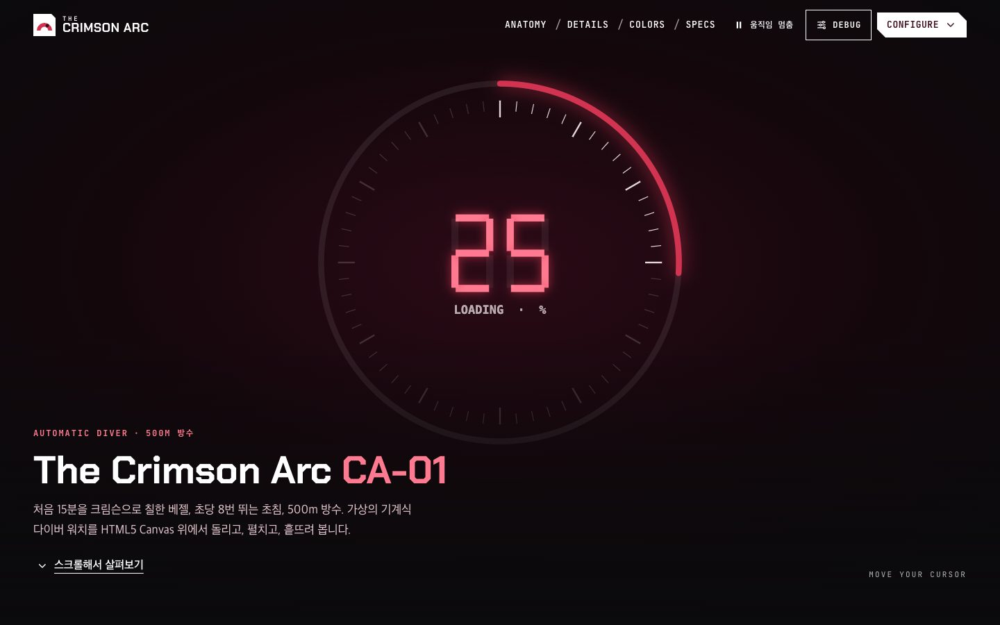 | 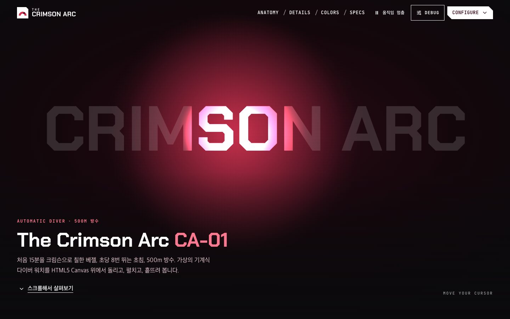 |

| Anatomy (360도 회전)                                                                              | Anatomy (분해)                                                                                              |
| ------------------------------------------------------------------------------------------------- | ----------------------------------------------------------------------------------------------------------- |
| 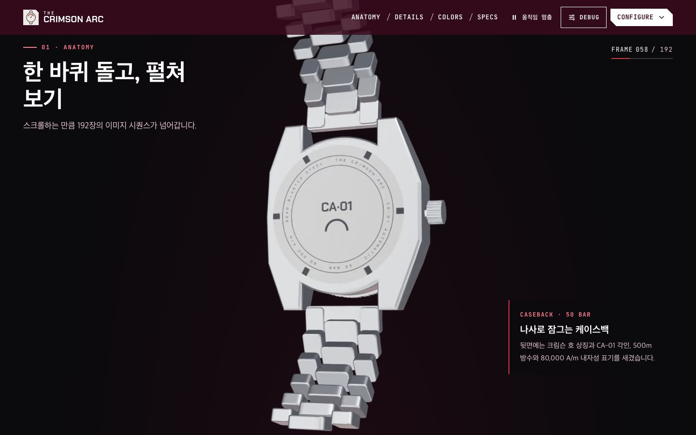 | 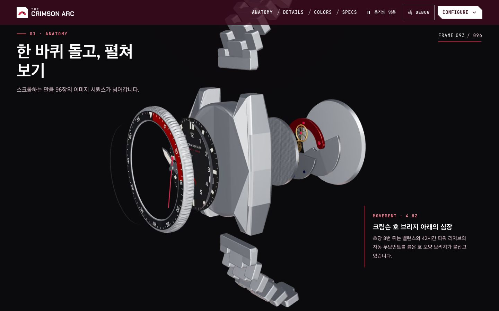 |

| Details (입자 실루엣)                                                                     | Details (마우스에 흩어지는 입자)                                                     |
| ----------------------------------------------------------------------------------------- | ------------------------------------------------------------------------------------ |
| 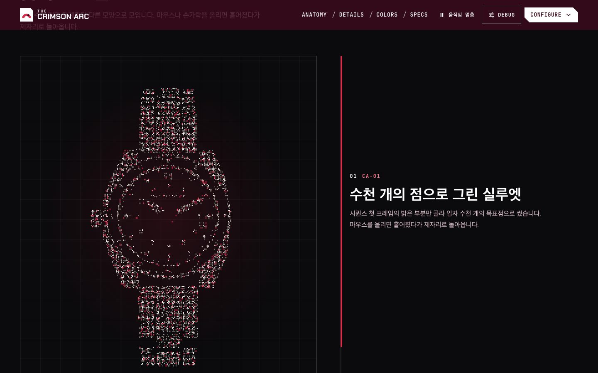 | 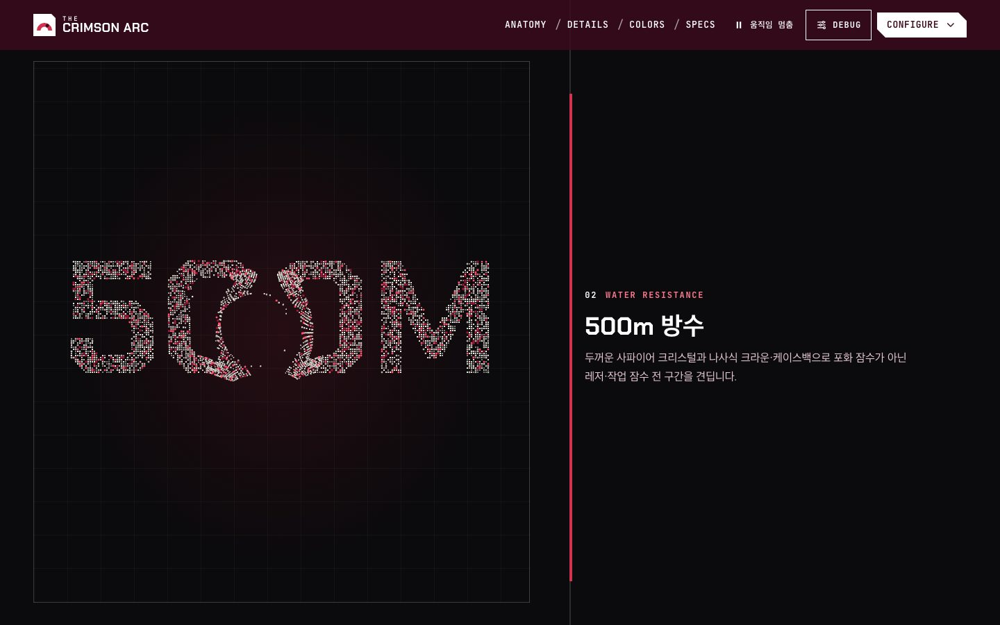 |

| Colors (색·재질 구성기)                                                                       | lil-gui 디버그 패널                                                                             |
| --------------------------------------------------------------------------------------------- | ----------------------------------------------------------------------------------------------- |
| 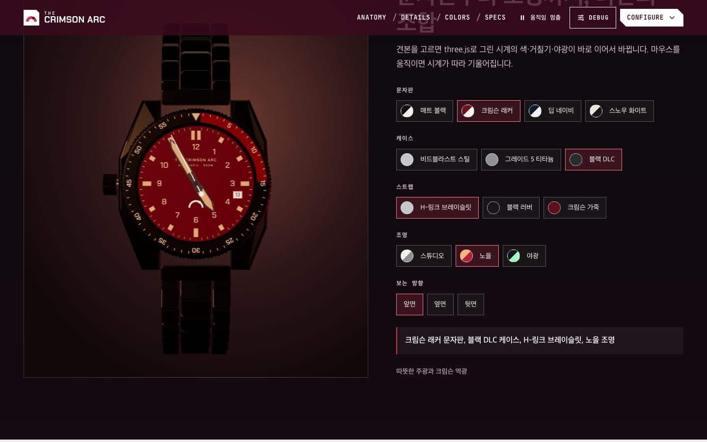 | 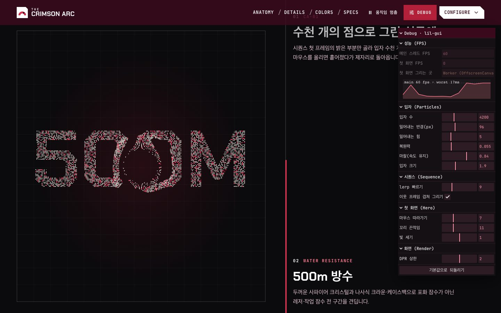 |

| 성능 비교 (`/bench/`)                                            | 편집기 소개 (`/editor/`)                                                                                  |
| ---------------------------------------------------------------- | --------------------------------------------------------------------------------------------------------- |
| 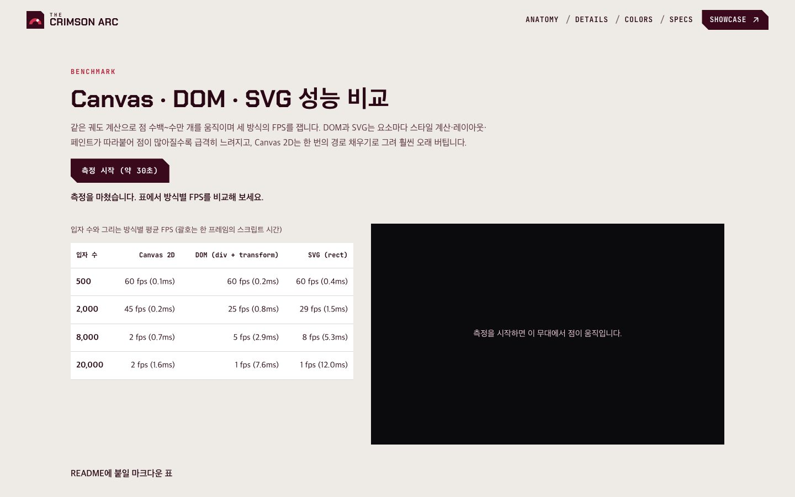 | 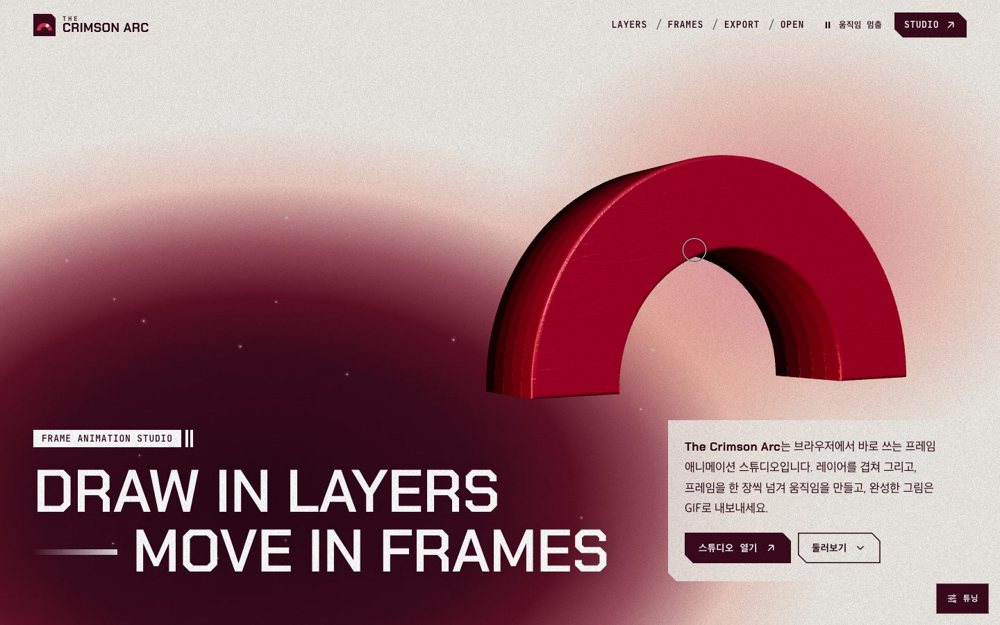 |

| 모바일 첫 화면                                                                                                     | 모바일 분해                                                                                              | Storybook                                                                             |
| ------------------------------------------------------------------------------------------------------------------ | -------------------------------------------------------------------------------------------------------- | ------------------------------------------------------------------------------------- |
| 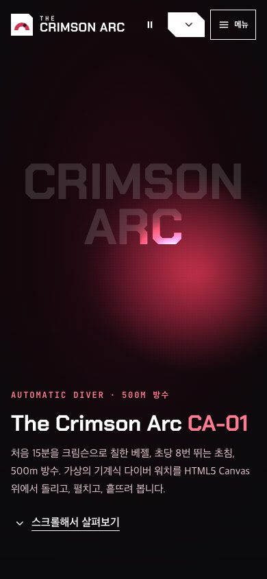 | 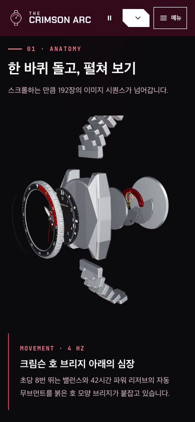 | 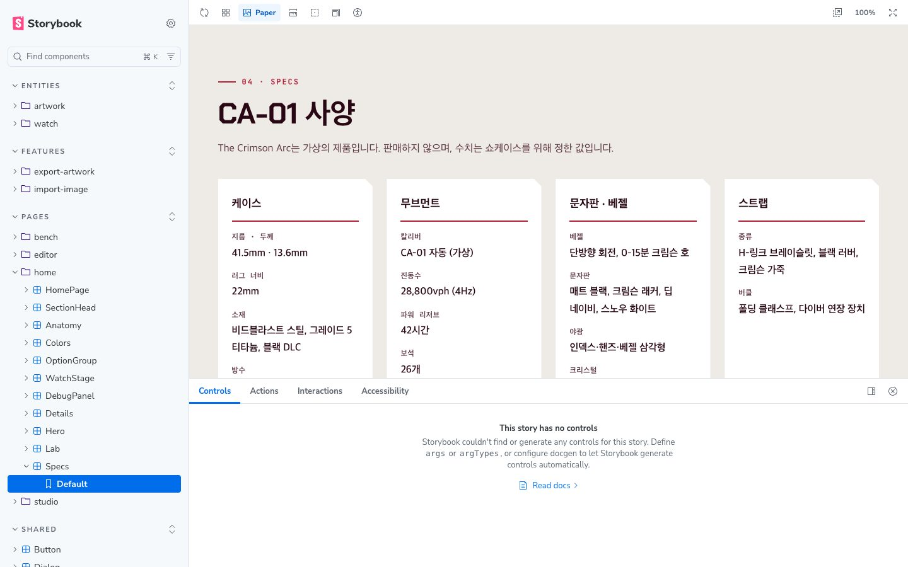 |

## 주요 기능

| 구간        | 내용                                                                                                                                          |
| ----------- | --------------------------------------------------------------------------------------------------------------------------------------------- |
| 첫 화면     | OffscreenCanvas Worker가 그리는 로딩 애니메이션(눈금·크림슨 호·7세그먼트 %), 다 받으면 마우스를 lerp로 따라가며 제목 글자 안을 흐르는 빛      |
| Anatomy     | 스크롤 진행도에 맞춘 192장 이미지 시퀀스(AVIF·WebP). 2.8°씩 한 바퀴 돈 뒤 분해, lerp와 이웃 프레임 겹쳐 그리기, 핵심 프레임부터 촘촘하게 받기 |
| Details     | `Particle` 클래스로 만든 입자 수천 개가 실루엣·500M·4Hz·42H로 모이고, 마우스와의 거리로 밀려났다가 복원력으로 돌아옴                          |
| Colors      | three.js 시계의 문자판·케이스·스트랩·조명(야광 포함)과 보는 방향을 고르면 색·거칠기·빛이 lerp로 바뀜                                          |
| 디버그 패널 | 헤더 오른쪽 위 **Debug**: 입자 수·반발력·복원력·마찰, 시퀀스 lerp, DPR 상한, 메인 스레드·Worker FPS 그래프                                    |
| 실험실      | `/bench/` Canvas·DOM·SVG 성능 비교, `/editor/` 0.1.0 편집기 소개, `/studio/` 레이어·프레임·GIF 내보내기를 갖춘 픽셀 애니메이션 스튜디오       |

## 기술 스택


| 구분        | 사용 기술                                                                                                                                                               |
| ----------- | ----------------------------------------------------------------------------------------------------------------------------------------------------------------------- |
| 프레임워크  | React 19, TypeScript 6, Vite 8 (쇼케이스·편집기 소개·스튜디오·성능 비교·404 다중 페이지)                                                                                |
| 그래픽      | HTML5 Canvas 2D API, OffscreenCanvas + Web Worker, React Three Fiber 9, @react-three/drei 10, three.js                                                                  |
| 모션        | lenis, lerp·damp 직접 구현, lil-gui                                                                                                                                     |
| 이미지      | AVIF·WebP 시퀀스(sharp로 생성), 직접 구현한 GIF89a 인코더·디코더                                                                                                        |
| 스타일      | CSS Modules, CSS 변수 디자인 토큰, Chakra Petch·JetBrains Mono (@fontsource)                                                                                            |
| 품질        | ESLint (jsx-a11y strict), Prettier, Steiger (FSD), Vitest + Testing Library·React Three Test Renderer, Playwright E2E(Chromium·WebKit) + axe, Lighthouse CI, size-limit |
| 문서 · 배포 | Storybook 10 (addon-a11y), GitHub Pages, GitHub Actions                                                                                                                 |

입자 2만 개를 움직이면 Canvas 2D는 60fps(스크립트 1.7ms)를 지키고 DOM은 20fps, SVG는 26fps로 떨어집니다. 측정 방법과 표, DPR·OffscreenCanvas·`cancelAnimationFrame` 문제 해결은 [Canvas 렌더링 노트](docs/canvas.md)에 있습니다.

## 시작하기

Node.js 26(`.nvmrc`)과 pnpm 12가 필요합니다.

```bash
nvm use
corepack enable pnpm
pnpm install
pnpm dev    # http://localhost:5173 (편집기 소개 /editor/, 스튜디오 /studio/, 성능 비교 /bench/)
```

| 명령                                   | 설명                                                    |
| -------------------------------------- | ------------------------------------------------------- |
| `pnpm build` / `build:all`             | 프로덕션 빌드 / Storybook(`dist/storybook`) 포함        |
| `pnpm storybook`                       | Storybook 개발 서버 (`http://localhost:6006`)           |
| `pnpm lint` / `lint:fsd` / `typecheck` | ESLint / FSD(Steiger) / 타입 검사                       |
| `pnpm test` / `test:e2e`               | 단위·컴포넌트 테스트 / 프로덕션 빌드 E2E (먼저 `build`) |
| `pnpm size` / `lhci`                   | 번들·시퀀스 용량 예산 / Lighthouse CI                   |
| `pnpm sequence`                        | 시계 이미지 시퀀스 192장 다시 만들기 (AVIF·WebP)        |

## 프로젝트 구조

```
src/
├─ app/        진입점(쇼케이스·편집기 소개·스튜디오·성능 비교·404), 전역 스타일과 토큰
├─ pages/      home(첫 화면 Worker, 시퀀스, 입자, 구성기, 디버그 패널), editor, studio, bench, render
├─ widgets/    site-header, site-footer
├─ features/   export-artwork(GIF·PNG 내보내기), import-image(열기·스튜디오로 넘기기)
├─ entities/   watch(시계 설정·3D 모델·시퀀스), artwork(레이어·프레임 모델)
└─ shared/     lib(canvas, preload, particles, gif, math, scroll, motion …), ui, config
public/sequence/  시계 이미지 시퀀스 192장 (lg 960px AVIF · sm 540px AVIF·WebP)
e2e/              Playwright E2E (화면 폭, axe, 키보드, 시퀀스·입자·구성기, 편집·내보내기)
scripts/          시퀀스·README 화면·공유 이미지 생성
```

## 문서

| 문서                                 | 내용                                                                      |
| ------------------------------------ | ------------------------------------------------------------------------- |
| [개발 가이드](docs/development.md)   | 페이지 구성, 구간별 렌더러, 시계 모델과 시퀀스 생성, 접근성, 테스트, 배포 |
| [Canvas 렌더링 노트](docs/canvas.md) | 왜 Canvas인가, 방식별 성능 비교, DPR·OffscreenCanvas·루프 문제 해결       |
| [버전 기록](CHANGELOG.md)            | 버전별 변경 내용                                                          |

## 출처

| 자료                                              | 저작자                                          | 사용 허락   | 원본                                                                                                                     |
| ------------------------------------------------- | ----------------------------------------------- | ----------- | ------------------------------------------------------------------------------------------------------------------------ |
| Chakra Petch 글꼴 (영문 제목, 큰 제목, 입자 글자) | The Chakra Petch Project Authors (Cadson Demak) | SIL OFL 1.1 | [Google Fonts](https://fonts.google.com/specimen/Chakra+Petch) · [Fontsource](https://fontsource.org/fonts/chakra-petch) |
| JetBrains Mono 글꼴 (라벨·숫자)                   | The JetBrains Mono Project Authors              | SIL OFL 1.1 | [JetBrainsMono](https://github.com/JetBrains/JetBrainsMono) · [Fontsource](https://fontsource.org/fonts/jetbrains-mono)  |
| three.js (3D 시계)                                | three.js authors                                | MIT         | [three.js](https://github.com/mrdoob/three.js)                                                                           |
| React Three Fiber · drei (3D 장면)                | Poimandres                                      | MIT         | [react-three-fiber](https://github.com/pmndrs/react-three-fiber) · [drei](https://github.com/pmndrs/drei)                |
| lenis (부드러운 스크롤)                           | darkroom.engineering                            | MIT         | [lenis](https://github.com/darkroomengineering/lenis)                                                                    |
| lil-gui (디버그 패널)                             | George Michael Brower                           | MIT         | [lil-gui](https://github.com/georgealways/lil-gui)                                                                       |
| sharp (시퀀스 이미지 변환)                        | Lovell Fuller                                   | Apache-2.0  | [sharp](https://github.com/lovell/sharp)                                                                                 |

로고, 시계 3D 모델과 이미지 시퀀스, 문자판·베젤·케이스백 인쇄, 아이콘, 편집기 소개와 스튜디오의 샘플 그림, 화면 사진은 이 프로젝트에서 직접 만들었습니다. 한글 본문은 글꼴을 따로 받지 않고 운영체제 글꼴을 씁니다.
