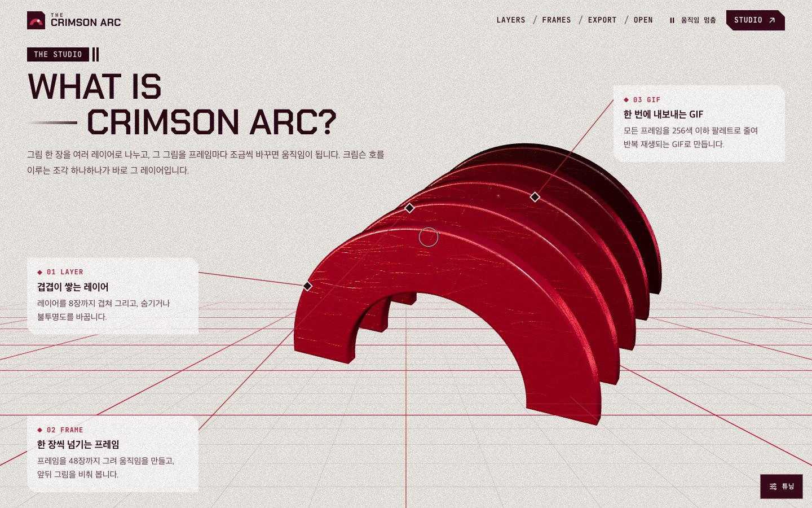
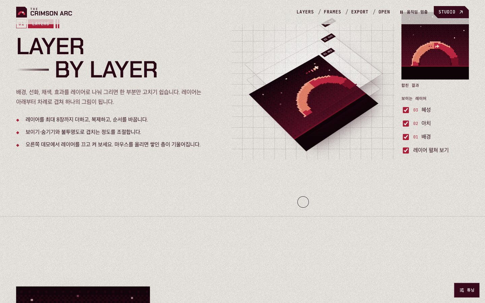
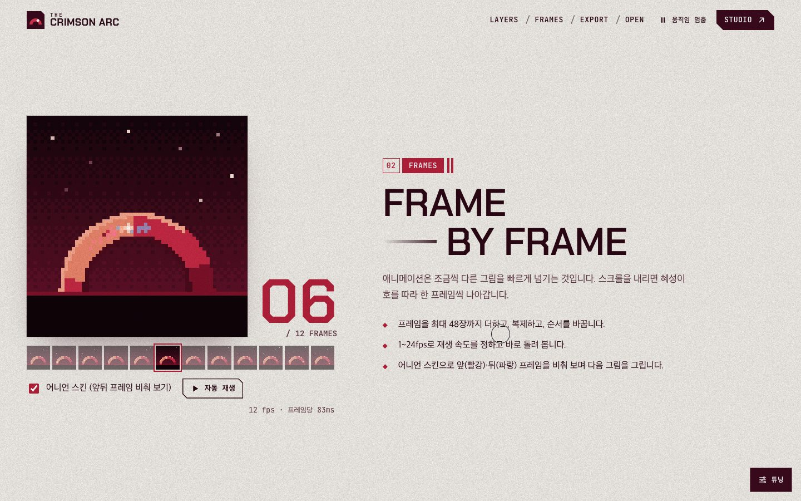
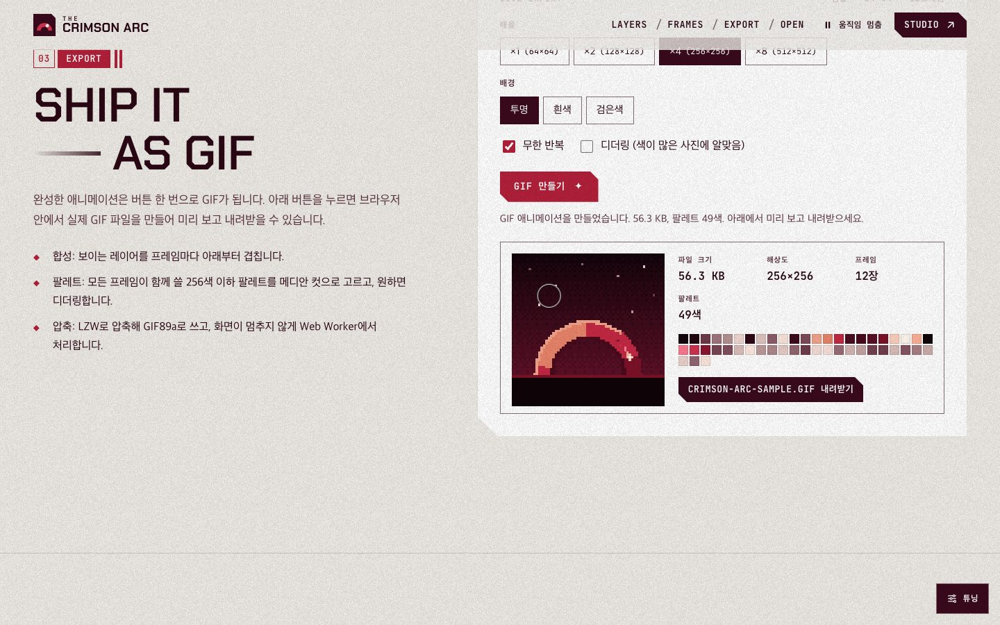
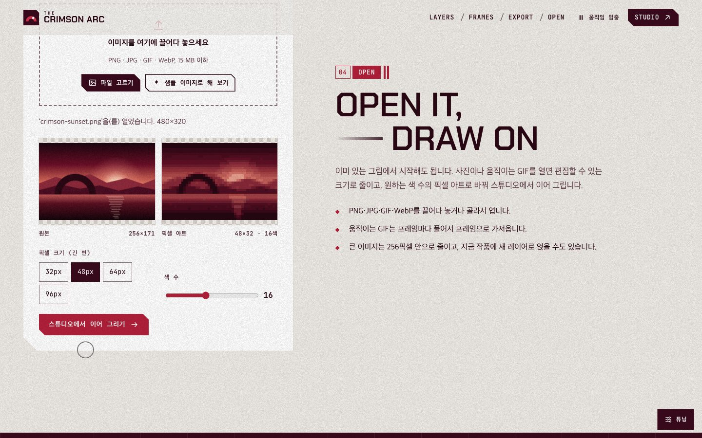
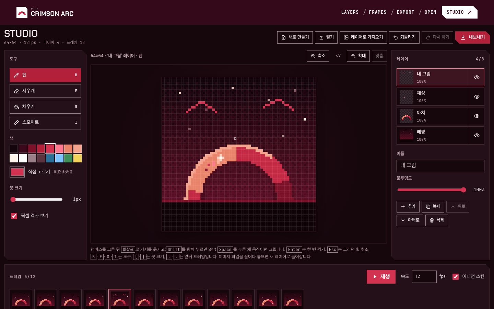
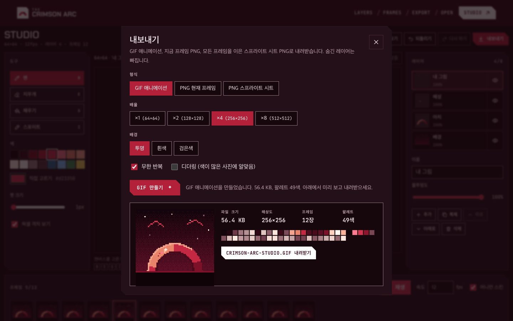
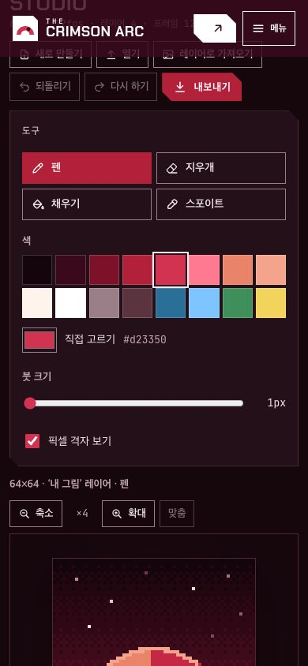

# The Crimson Arc - 프레임 애니메이션 스튜디오 브랜드 쇼케이스

[](https://github.com/ryushin01/TheCrimsonArc/actions/workflows/ci.yml)


가상의 프레임 애니메이션 편집기 **The Crimson Arc**를 홍보하는 스크롤·마우스 반응형 브랜드 쇼케이스입니다. 크림슨 호가 스크롤에 따라 레이어처럼 펼쳐지고, 레이어·애니메이션 프레임·GIF 내보내기·기존 이미지 열기 데모와 스튜디오가 Canvas 2D로 실제로 동작합니다.

**[데모 바로 보기](https://ryushin01.github.io/TheCrimsonArc/)** · [스튜디오](https://ryushin01.github.io/TheCrimsonArc/studio/) · [Storybook](https://ryushin01.github.io/TheCrimsonArc/storybook/index.html) · 주소에 `?gui`를 붙이면 lil-gui 튜닝 패널이 열린 채로 시작합니다.

> **프로젝트 상태:** 0.1.0까지 만든 **개인 프로젝트**입니다. The Crimson Arc는 가상의 제품이며 판매하지 않습니다. 디자인은 [Solais](https://www.cssdesignawards.com/sites/solais/48954/)의 시각 언어(그레인, 크림슨 그라데이션, 금속 3D 오브젝트, 깎은 모서리)를 참고했고, 로고·3D 모델·샘플 그림은 모두 코드로 직접 만들었습니다.

## 화면

| 첫 화면                                                                                           | 소개 (펼쳐지는 조각과 지시선)                                                                                           |
| ------------------------------------------------------------------------------------------------- | ----------------------------------------------------------------------------------------------------------------------- |
|  |  |

| 01 레이어                                                                                         | 02 프레임 (스크롤로 넘기기)                                                                |
| ------------------------------------------------------------------------------------------------- | ------------------------------------------------------------------------------------------ |
|  |  |

| 03 GIF 내보내기                                                                            | 04 이미지 열기                                                                           |
| ------------------------------------------------------------------------------------------ | ---------------------------------------------------------------------------------------- |
|  |  |

| 스튜디오                                                                                                  | 스튜디오 내보내기                                                                               |
| --------------------------------------------------------------------------------------------------------- | ----------------------------------------------------------------------------------------------- |
|  |  |

| 모바일 첫 화면                                                                                                          | 모바일 스튜디오                                                                                              | Storybook                                                                             |
| ----------------------------------------------------------------------------------------------------------------------- | ------------------------------------------------------------------------------------------------------------ | ------------------------------------------------------------------------------------- |
|  |  |  |

## 주요 기능

**홍보 페이지**

| 구간       | 내용                                                                                                                                |
| ---------- | ----------------------------------------------------------------------------------------------------------------------------------- |
| 첫 화면    | React Three Fiber로 그린 크림슨 호(Canvas 2D로 만든 흠집 질감, drei Lightformer 환경광), 마우스를 lerp로 따라 기울어짐, 필름 그레인 |
| 소개       | 스크롤하면 호의 조각(레이어)이 펼쳐지고 drei 격자가 깔림, 3D 좌표를 화면에 투영한 지시선 주석                                       |
| 작동 원리  | 빛줄기(InstancedMesh) 속으로 멀어지는 호와 네 단계 목차                                                                             |
| 01~04 데모 | 레이어 켜고 끄기, 스크롤로 넘기는 플립북과 어니언 스킨, 실제 GIF 만들기, 이미지·움직이는 GIF를 픽셀 아트로 바꿔 스튜디오로 넘기기   |
| 연출       | lenis 부드러운 스크롤, 스크롤 속도에 반응하는 흐르는 글자, lerp 커서 링, lil-gui 튜닝 패널, 자동 움직임 멈춤 버튼                   |

**스튜디오** (`/studio/`)

| 기능            | 내용                                                                                                      |
| --------------- | --------------------------------------------------------------------------------------------------------- |
| 그리기          | 펜·지우개·채우기·스포이트, 붓 크기 1~8, 16색 팔레트와 색 고르기, 픽셀 격자, 확대 ×1~×32, 키보드 그리기    |
| 레이어 · 프레임 | 레이어 8장(보이기·불투명도·이름·순서·복제), 프레임 48장(1~24fps 재생, 어니언 스킨, 복제·순서)             |
| 열기 · 내보내기 | PNG·JPG·GIF·WebP 열기(움직이는 GIF는 프레임째, 끌어다 놓으면 새 레이어), GIF89a·PNG·스프라이트 시트 ×1~×8 |
| 편집            | 되돌리기 50단계(Ctrl/⌘+Z), 화면 낭독기 알림, 떠나기 전 확인                                               |

## 기술 스택


| 구분        | 사용 기술                                                                                                                    |
| ----------- | ---------------------------------------------------------------------------------------------------------------------------- |
| 프레임워크  | React 19, TypeScript 6, Vite 8 (홍보·스튜디오·404 다중 페이지)                                                               |
| 그래픽      | HTML5 Canvas 2D API (픽셀 편집·합성, 텍스처·그레인 생성), React Three Fiber 9, @react-three/drei 10, three.js                |
| 모션        | lenis, lerp·damp 직접 구현, lil-gui                                                                                          |
| GIF         | 직접 구현한 GIF89a 인코더·디코더 (LZW, 메디안 컷, 플로이드–스타인버그 디더링), Web Worker                                    |
| 스타일      | CSS Modules, CSS 변수 디자인 토큰, Chakra Petch·JetBrains Mono (@fontsource)                                                 |
| 품질        | ESLint (jsx-a11y strict), Prettier, Steiger (FSD), Vitest + Testing Library, Playwright E2E + axe, Lighthouse CI, size-limit |
| 문서 · 배포 | Storybook 10 (addon-a11y), GitHub Pages, GitHub Actions                                                                      |

## 시작하기

Node.js 26(`.nvmrc`)과 pnpm 12가 필요합니다.

```bash
nvm use
corepack enable pnpm
pnpm install
pnpm dev    # http://localhost:5173 (스튜디오: /studio/)
```

| 명령                                   | 설명                                             |
| -------------------------------------- | ------------------------------------------------ |
| `pnpm build` / `build:all`             | 프로덕션 빌드 / Storybook(`dist/storybook`) 포함 |
| `pnpm storybook`                       | Storybook 개발 서버 (`http://localhost:6006`)    |
| `pnpm lint` / `lint:fsd` / `typecheck` | ESLint / FSD(Steiger) / 타입 검사                |
| `pnpm test`                            | 단위·컴포넌트 테스트                             |
| `pnpm test:e2e`                        | 프로덕션 빌드 E2E (먼저 `build` 필요)            |
| `pnpm size` / `lhci`                   | 번들 크기 예산 / Lighthouse CI                   |

## 프로젝트 구조

```
src/
├─ app/        진입점(홍보·스튜디오·404), 전역 스타일과 디자인 토큰
├─ pages/      home(섹션, 3D 무대, 효과), studio(편집기), not-found
├─ widgets/    site-header, site-footer
├─ features/   export-artwork(GIF·PNG 내보내기), import-image(열기·스튜디오로 넘기기)
├─ entities/   artwork(레이어·프레임 모델, 합성, 샘플 작품)
└─ shared/     lib(gif, pixel, math, scroll, motion …), ui, config
e2e/           Playwright E2E (화면 폭, axe, 키보드, 편집·내보내기·열기 흐름)
scripts/       README 화면·공유 이미지 생성
```

## 문서

| 문서                               | 내용                                                               |
| ---------------------------------- | ------------------------------------------------------------------ |
| [개발 가이드](docs/development.md) | 구조, 3D 무대와 스크롤 구간, GIF 인코더, 접근성 점검, 테스트, 배포 |
| [버전 기록](CHANGELOG.md)          | 버전별 변경 내용                                                   |
